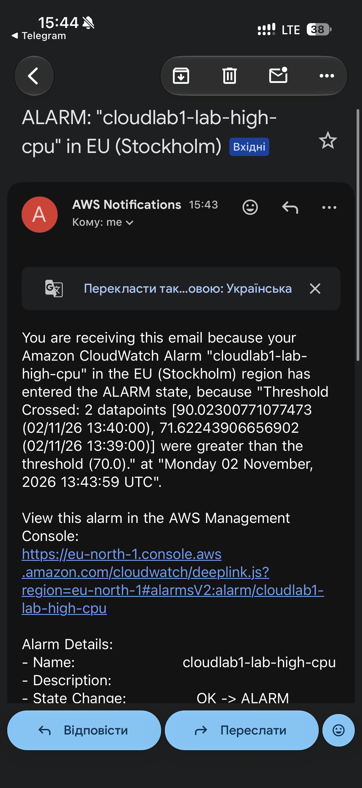
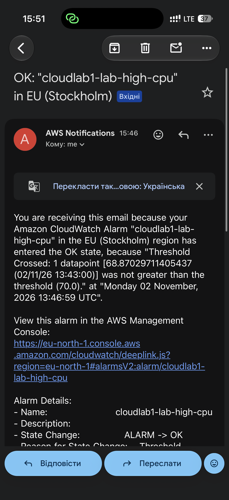

# Email Alerts

## Alert Configuration

The monitoring system uses AWS CloudWatch and Amazon SNS
to send email notifications when CPU utilization is too high.

- Metric: CPUUtilization (AWS/ECS)
- Threshold: CPU > 70%
- Evaluation period: 2 consecutive periods of 60 seconds
- Notification service: Amazon SNS
- Alarm: cloudlab1-lab-high-cpu

The 70% threshold was chosen to detect high CPU usage
before the service becomes completely overloaded.
The two-minute evaluation period helps prevent false
alarms caused by short CPU spikes.

## Test Results

During the k6 load test with 20 virtual users,
the alarm was triggered when CPU utilization exceeded 70%.

The monitored values were 71.62% and 90.02%.

The alarm entered the ALARM state on
November 2, 2026, at 15:43:59 (Kyiv time).

The CPU utilization later decreased to 68.87%.
The alarm returned to the OK state at
15:46:59 (Kyiv time).

Both email notifications were successfully received.

## Email Screenshots

### High CPU Alert

### Recovery Notification

## Response Time Analysis

The alarm requires two consecutive one-minute periods
above the threshold before triggering.

Additional delay is caused by CloudWatch metric
collection, alarm evaluation, and SNS email delivery.

This delay is acceptable for a student laboratory
service. For a production service, faster monitoring
or additional latency-based alerts may be needed.

During the test, 99.84% of HTTP requests failed.
This indicates a significant service availability
problem under load, even though email alerting worked.

The steady load phase started at approximately 15:40:52.

The ALARM notification was triggered at 15:43:59.

The estimated response time from the beginning of
steady load to the ALARM state was 3 minutes and
7 seconds.

The alarm returned to OK at 15:46:59.

These times are approximate because the test start
time was reconstructed from the k6 duration and
the results file modification time.
