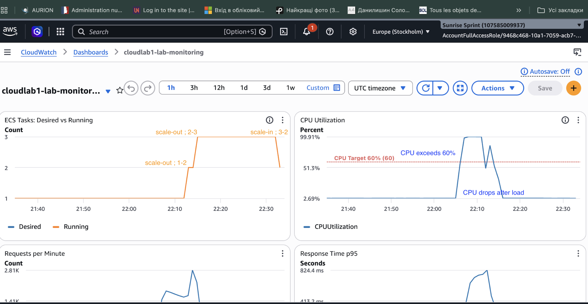
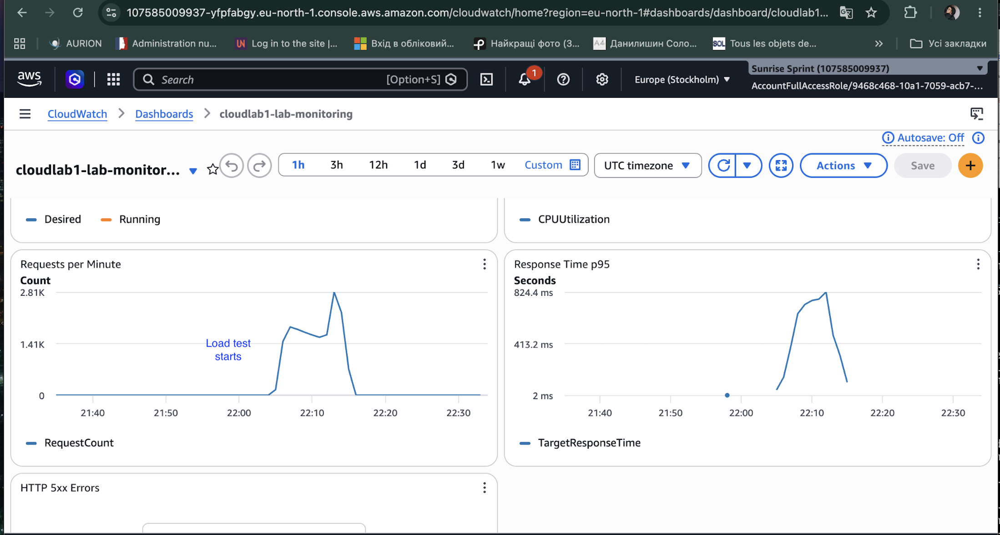

# Automatic Scaling

## Configuration

- Provider: AWS ECS Fargate
- Scaling: Horizontal, CPU-based
- Minimum tasks: 1
- Maximum tasks: 3
- Target CPU: 60%
- Scale-out cooldown: 60 seconds
- Scale-in cooldown: 300 seconds

## Justification

The CPU target of 60% leaves spare capacity
for increasing workloads.

The maximum of 3 tasks limits AWS costs.

## Cooldown

Cooldown helps prevent frequent scaling changes.

Without cooldown, the service could scale
too frequently, causing instability and
unnecessary resource usage.

The scale-out cooldown is 60 seconds, allowing
the service to respond relatively quickly to
increasing CPU utilization.

The scale-in cooldown is 300 seconds, helping
prevent premature removal of running tasks.

## Test Results

During the k6 load test with 20 virtual users,
CPU utilization exceeded the target of 60%
and reached approximately 99%.

AWS successfully increased the number of
running ECS tasks from 1 to 2 and then to 3.

After the load test, CPU utilization decreased
to approximately 2.7%.

AWS gradually reduced the number of running
tasks from 3 to 2 and then back to 1.

This confirmed that both scale-out and
scale-in were functioning.

## Monitoring

The CloudWatch Dashboard contains five graphs:

- Desired and running ECS tasks
- CPU utilization
- Requests per minute
- Response time p95
- HTTP 5xx errors

### Autoscaling and CPU Utilization

### Requests and Response Time

## Scaling Analysis

During the load test, CPU utilization increased
above the configured 60% target.

As CPU utilization increased, AWS automatically
added new ECS tasks to handle the additional load.

The number of running tasks increased from
1 to 2 and then to 3.

After the load test ended, CPU utilization
decreased significantly.

AWS gradually reduced the number of tasks
from 3 to 1.

Scaling does not happen immediately because
AWS needs time to collect and evaluate
CloudWatch metrics.

Starting new ECS tasks also requires time
for container initialization and health checks.

Scale-in happens more slowly because AWS
must avoid removing tasks too early while
the service is still processing requests.

The configured cooldown periods are:

- Scale-out: 60 seconds
- Scale-in: 300 seconds

These settings help maintain service stability
and avoid unnecessary scaling changes.

## Conclusion

The automatic scaling policy worked successfully
during the load test.

AWS ECS increased the number of tasks when
CPU utilization exceeded the target and
reduced the number of tasks after the
workload decreased.

The service scaled between 1 and 3 tasks,
as configured in Terraform.
