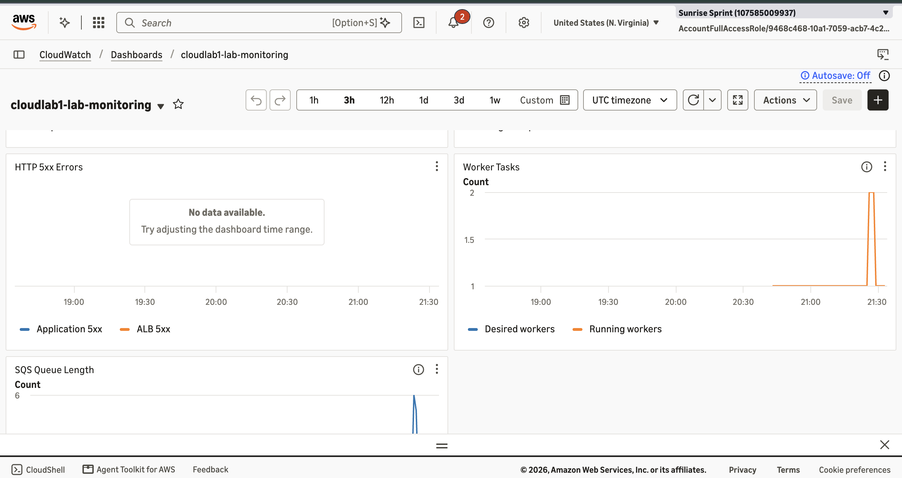
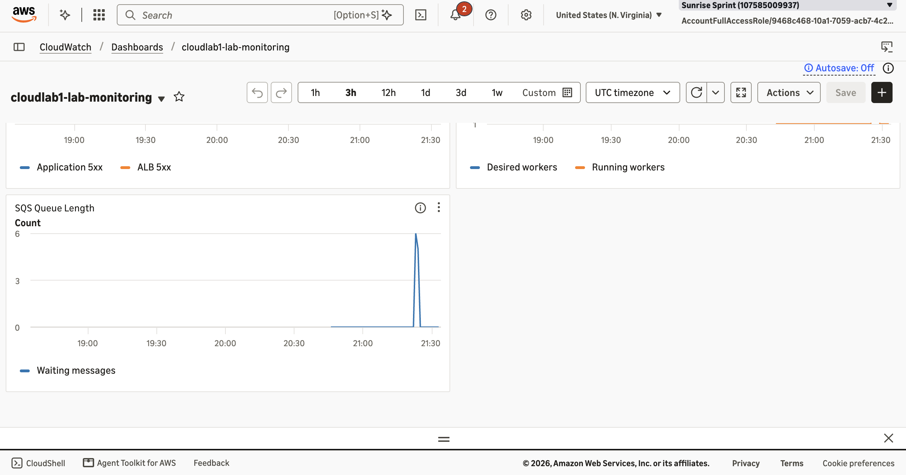
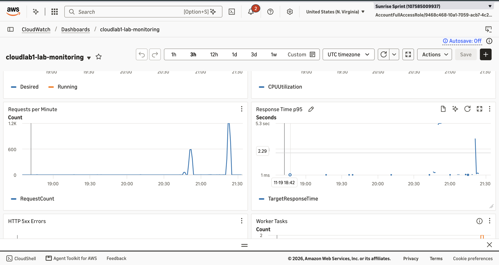

# Bonus Task 6 — Asynchronous Processing with Amazon SQS

## Implementation

Amazon SQS is used for asynchronous order processing.

- POST /async-orders sends an order to the SQS queue.
- The API returns HTTP 202 Accepted without waiting for database insertion.
- A separate ECS worker receives messages and saves orders to PostgreSQL.
- Worker autoscaling is based on SQS queue length.
- CloudWatch monitors queue length and worker count.

## Load Testing

Load testing was performed using k6.

| Metric | Baseline (v1) | Under load (v1) | Optimized (v2) |
|---|---:|---:|---:|
| Target requests/s | 1 | 20 | 20 |
| Total requests | 120 | 1802 | 3538 |
| Average latency | 142.06 ms | 3910.82 ms | 160.63 ms |
| p95 latency | 335.58 ms | 5304.24 ms | 324.14 ms |
| HTTP error rate | 0% | 0% | 0% |
| Dropped iterations | 0 | 1799 | 63 |

## Optimization

The initial implementation created a new SQS client for every API request.

Reusing the boto3 client significantly reduced response latency.

After optimization, the API achieved 19.63 requests per second, and all completed requests returned HTTP 202 Accepted.

## Autoscaling Results

Under load, the number of running workers increased from 1 to 2 and subsequently returned to 1.

The observed number of waiting messages reached approximately 6 and then returned to 0.

## CloudWatch Screenshots

### Worker Autoscaling

### SQS Queue Length

### API Performance

## Conclusion

Asynchronous order processing and worker autoscaling were successfully demonstrated.

After optimization, p95 latency under higher load was comparable to the initial baseline. However, 63 scheduled iterations were dropped, so the full requested load was not achieved.
